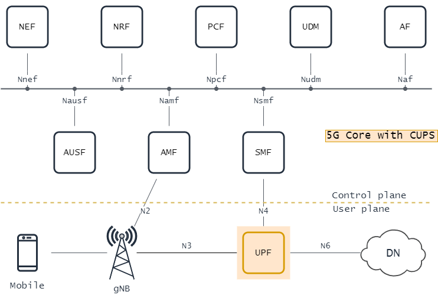
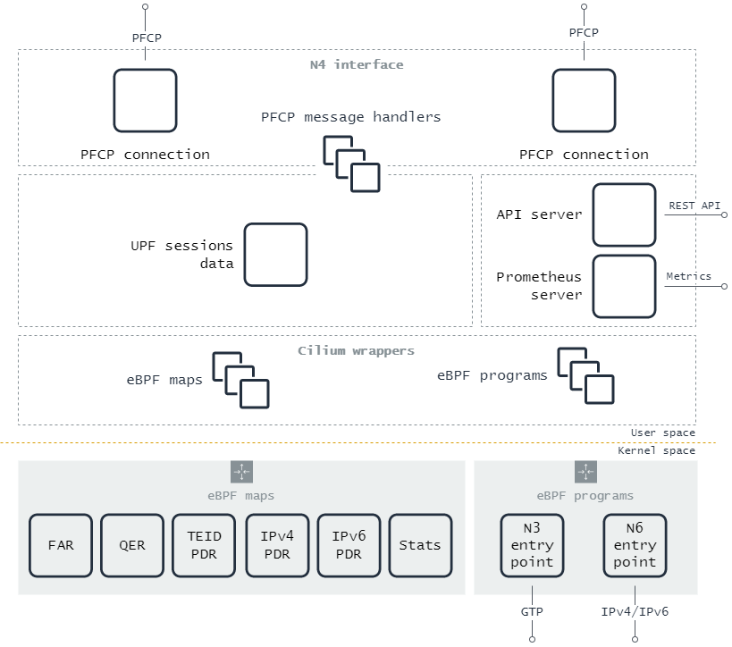

<div align="center">

[![Build][build-img]][build]
[![Test][test-img]][test]
[![License: Apache-2.0][license-img]][license]

</div>

# eUPF

eUPF is the opensource User Plane Function (UPF) project for using inside or "outside" of any 3GPP 5G core. The goal of the project is to provide high-observability and easily-deployed software for a various cases like multi-access edge computing (MEC) and local traffic breakout. eUPF is built with eBPF to provide high observability and performance.

 The eUPF has been tested with three different 5G cores: Free5GC, Open5GS and OpenAirInterface. The OpenAirInterface gNB was also used during testing.

## What is 5G core and CUPS

5G core uses network virtualized functions (NVF) to provide connectivity and services.
Control and user plane separation (CUPS) is important architecture enhancement that separates control plane and user plane inside 5G core.
User plane function (UPF) is the "decapsulating and routing" function that extracts user plane traffic from GPRS tunneling protocol (GTP) and route it to the public data network or local network via the best available path.



## Quick start guide

Super fast & simple way is to download and run our docker image. The example exposes the API on host loopback and supplies a fresh management token:
```bash
export UPF_API_TOKEN="$(openssl rand -hex 32)"
sudo docker run -d --rm \
  --cap-add=NET_ADMIN --cap-add=SYS_RESOURCE --cap-add=BPF --cap-add=PERFMON \
  -v /sys/fs/bpf:/sys/fs/bpf \
  -v /sys/kernel/debug:/sys/kernel/debug:ro \
  -e UPF_API_ADDRESS=:8080 -e UPF_API_TOKEN="$UPF_API_TOKEN" \
  -p 127.0.0.1:8080:8080 -p 127.0.0.1:9090:9090 --name your-eupf-def \
   ghcr.io/gomaja-labs/go-eupf:main
```
### Notes
- 📝 *Linux Kernel **5.15.0-25-generic** is the minimum release version it has been tested on. Previous versions are not supported.*
- ℹ The eBPF filesystem must be mounted in the host filesystem allowing the eUPF to persist eBPF resources across restarts so that the datapath can continue to operate while the eUPF is subsequently restarted or upgraded.
Use following command to mount it: `sudo mount bpffs /sys/fs/bpf -t bpf`
- ℹ The eupf binary has file capabilities for NET_ADMIN, SYS_RESOURCE, BPF, PERFMON and DAC_OVERRIDE. Docker's bounding set must include them: DAC_OVERRIDE is included by default; add the other four with `--cap-add` as above. A non-root container needs a pre-mounted BPF filesystem (the Helm chart uses this mode). Without the required capabilities, exec of the binary fails with `Operation not permitted`.
- ℹ During startup eupf sets rlimits, so corresponding privileges are required (ulimit)

<details><summary><i>See startup parameters you might want to change</i></summary>
<p>

   - UPF_INTERFACE_NAME=eth0  *Network interfaces handling N3 (GTP) & N6 (SGi) traffic.*
   - UPF_N3_ADDRESS=127.0.0.1 *IPv4 address for N3 interface*
   - UPF_N9_ADDRESS=127.0.0.1 *IPv4 address for N9 interface*
   - UPF_XDP_ATTACH_MODE=generic *XDP attach mode. generic, native or offload (driver support required)*
   - UPF_API_ADDRESS=127.0.0.1:8080    *Local host:port for serving [REST API](docs/api.md) server*
   - UPF_PFCP_ADDRESS=127.0.0.1:8805   *Local host:port that PFCP server will listen to*
   - UPF_PFCP_NODE_ID=127.0.0.1  *Local NodeID for PFCP protocol. Format is a hostname or IP address*
   - UPF_METRICS_ADDRESS=:9090   *Local host:port for serving Prometheus metrics endpoint*
   - UPF_MAX_SESSIONS=65535      *Maximum number of sessions. Automatically sizes the eBPF maps when individual map sizes are not set*
   - UPF_PDR_MAP_SIZE=0          *Size of the PDR eBPF map. Overrides the value derived from max_sessions when set (non-zero). See also QER/FAR/URR_MAP_SIZE*
   - UPF_FEATURE_FTUP=false      *Enable F-TEID allocation / release in the UP function*
   - UPF_FEATURE_UEIP=false      *Enable UE IP address allocation*
   - UPF_UEIP_POOL=10.60.0.0/24  *IP pool for the UEIP feature*
   - UPF_TEID_POOL=65535         *TEID pool size for the FTUP feature*
</p>
</details>

In a real-world scenario, you would likely need to replace the interface names and IP addresses with values that are applicable to your environment. You can do so with the `-e` option, for example:

```bash
sudo docker run -d --rm \
  --cap-add=NET_ADMIN --cap-add=SYS_RESOURCE --cap-add=BPF --cap-add=PERFMON \
  -v /sys/fs/bpf:/sys/fs/bpf \
  -v /sys/kernel/debug:/sys/kernel/debug:ro \
  -p 127.0.0.1:8081:8081 -p 127.0.0.1:9091:9091 --name your-eupf-custom \
  -e UPF_INTERFACE_NAME=eth0,n6 -e UPF_XDP_ATTACH_MODE=generic \
  -e UPF_API_ADDRESS=:8081 -e UPF_API_TOKEN="$UPF_API_TOKEN" -e UPF_PFCP_ADDRESS=:8806 \
  -e UPF_METRICS_ADDRESS=:9091 -e UPF_PFCP_NODE_ID=10.100.50.241 \
  -e UPF_N3_ADDRESS=10.100.50.233 \
  ghcr.io/gomaja-labs/go-eupf:main
```
## What's next?

Read **[eUPF configuration guide](./docs/Configuration.md)** for more info about how to configure eUPF.

See [advertised user-plane addresses](docs/advertised-addresses.md),
[data-plane settings and restart requirements](docs/dataplane-settings.md), and
[deferred requests](docs/roadmap.md). The [documentation index](docs/README.md)
lists the available guides.

To go further, see the **[eUPF installation guide](./docs/install.md)** to learn how to run eUPF in different environments with different 5G core implementations using docker-compose or Kubernetes cluster.

## Deploy to Kubernetes

eUPF ships with a Helm chart. Deploy it with:

```bash
helm install eupf .deploy/helm/eupf
```

See the **[Helm chart documentation](./.deploy/helm/eupf/README.md)** for the full list of values and deployment options.

For statistics you can gather, see the **[eUPF metrics and monitoring guide](./docs/metrics.md)**.

You can find different types of implementation in the **[Implementation examples](./docs/implementation_examples.md)**.

## Implementation notes

eUPF as a part of 5G mobile core network implements data network gateway function. It communicates with SMF via PFCP protocol (N4 interface) and forwards packets between core and data networks(N3 and N6 interfaces correspondingly). These two main UPF parts are implemented in two separate components: control plane and forwarding plane.

The eUPF control plane is an userspace application which receives packet processing rules from SMF and configures forwarding plane for proper forwarding.

The eUPF forwarding plane is based on eBPF packet processing. When started eUPF adds eBPF XDP hook program in order to process network packets as close to NIC as possible. eBPF program consists of several pipeline steps: determine PDR, apply gating, qos and forwarding rules.

eUPF relies on kernel routing when making routing decision for incoming network packets. When it is not possible to determine packet route via kernel FIB lookup, eUPF passes such packet to kernel as a fallback path. This approach obviously affects performance but allows maintaining correct kernel routing process (ex., filling arp tables).

### Brief functional description

#### FAR support

eUPF supports FAR rules in PDR. Only one FAR rule per PDR is supported.

#### QER support

eUPF supports QER rules in PDR. Currently only one QER rule per PDR is supported.

#### SDF filters support

eUPF is able to apply SDF filters in PDR. Currently only one SDF filter per GTP tunnel is supported.

#### GTP path management

eUPF supports sending GTP Echo requests towards neighbour GTP nodes. Every neighbour GTP node should be explicitly configured. [See](docs/Configuration.md) `gtp_peer` configuration parameter.

### Architecture

<details><summary>Show me</summary>

#### Eagle-eye overview


#### Detailed architecture


</details>

### Roadmap

<details><summary>Show me</summary>

#### Control plane

- [x]  PFCP Association Setup/Release and Heartbeats
- [x]  Session Establishment/Modification with support for PFCP entities such as Packet Detection Rules (PDRs), Forwarding Action Rules (FARs), QoS Enforcement Rules (QERs).
- [ ]  UPF-initiated PFCP association
- [x]  UPF-based UE IP address assignment

#### Data plane

- [x]  IPv4 support
- [x]  N3, N4, N6 interfaces
- [x]  Single & Multi-port support
- [x]  Static IP routing
- [x]  Basic QoS support with per-session rate limiting
- [x]  I-UPF/A-UPF ULCL/Branching (N9 interface)
- [x]  Configurable eBPF map sizing via `max_sessions`

#### Management plane
- [x]  Free5gc compatibility
- [x]  Open5gs compatibility
- [x]  Integration with Prometheus for exporting PFCP and data plane-level metrics
- [x]  REST API for inspecting and managing PFCP associations, sessions and eBPF maps
- [ ]  Monitoring/Debugging capabilities using tcpdump and cli

#### 3GPP specs compatibility
- [x]  `FTUP` F-TEID allocation / release in the UP function is supported by the UP function.
- [x]  `UEIP` Allocating UE IP addresses or prefixes.
- [ ]  `SSET` PFCP sessions successively controlled by different SMFs of a same SMF Set.
- [ ]  `MPAS` Multiple PFCP associations to the SMFs in an SMF set.
- [ ]  `QFQM` Per QoS flow per UE QoS monitoring.
- [ ]  `GPQM` Per GTP-U Path QoS monitoring.
- [ ]  `RTTWP` RTT measurements towards the UE Without PMF.

 </details>

## Running from sources

### Prerequisites

Linux kernel 5.15 or newer and Docker are required. The Dockerfile defines the
shared build and CI toolchain: Go 1.27.4, Debian bookworm and clang/LLVM 14.
The minimum supported Go version is the `go` directive in `go.mod` (1.26.0).
Code generators are pinned by Go tool directives; no global generator install is needed.

### Build and run

```bash
git clone https://github.com/gomaja-labs/go-eupf.git
cd go-eupf
docker build -t local/eupf:latest .
docker build --target cli -t local/eupf-cli:latest .
```

Run the application image with the capabilities and mounts shown in the quick
start above. For CLI usage, run `docker run --rm local/eupf-cli:latest eupf --help`.
Enable packet logging with `--build-arg BPF_ENABLE_LOG=1`. See
[data-plane behaviour and limits](docs/dataplane.md).

### Build and test from source

Build the development stage with your user ID so generated files remain yours:

```bash
docker build --target development --build-arg BUILD_UID="$(id -u)" \
  --build-arg BUILD_GID="$(id -g)" -t eupf-development .
docker run --rm --init --privileged -v "$PWD:/src" -w /src \
  eupf-development scripts/ci/check.sh test
docker run --rm --init -v "$PWD:/src" -w /src \
  eupf-development scripts/ci/check.sh lint
docker run --rm --init --privileged -v "$PWD:/src" -w /src \
  eupf-development scripts/ci/check.sh smoke
```

The scripts compile as your user and run eBPF test executables with `sudo` inside
the container's own network namespace. Smoke logs and PFCP captures are written
under `ci-results/`. No host network or host BPF filesystem is mounted.

For a native build, install Go 1.26 or newer and clang/LLVM 14, gcc-multilib and
libbpf-dev, then run `go generate ./cmd/...` and `go build -o bin/eupf ./cmd`.
Run `sudo ./bin/eupf` with appropriate network privileges in a test environment.
CI tests minimum and stable Go using the same Dockerfile toolchain stage.
Images are built and scanned on pull requests and published to GHCR only on
pushes to `main` and tags. CI never creates another branch.

### Hardware requirements

- CPU: any popular CPU is supported, incl. x86, x86_64, armhf, armv7, aarch64, ppc64le, s390x
- CPU_cores: 1 core is enough to run eUPF
- RAM: you need up to 70MB to run eUPF and up to 512MB to run Linux kernel
- HDD: 50MB of free space is required to install eUPF. Different types of storage can be used: HDD, SSD, SD-card, USB-stick
- NIC: Any internal or external networking interface that can be used in Linux

## Contribution

Please create an issue to report a bug or share an idea. See our [Contributing Guide](./CONTRIBUTING.md) for details.

## License
This project is licensed under the [Apache License 2.0](https://www.apache.org/licenses/LICENSE-2.0) - see the [LICENSE](./LICENSE) and [NOTICE](./NOTICE) files for details

---

[build]: https://github.com/gomaja-labs/go-eupf/actions/workflows/build.yml
[build-img]: https://github.com/gomaja-labs/go-eupf/actions/workflows/build.yml/badge.svg
[test]: https://github.com/gomaja-labs/go-eupf/actions/workflows/ci.yml
[test-img]: https://github.com/gomaja-labs/go-eupf/actions/workflows/ci.yml/badge.svg
[license]: https://github.com/gomaja-labs/go-eupf/blob/main/LICENSE
[license-img]: https://img.shields.io/badge/License-Apache%202.0-blue.svg

### Administration security

The REST API defaults to `127.0.0.1:8080`. Set `api_token` or `UPF_API_TOKEN` before binding it to a non-loopback address. When configured, the token is required as `Authorization: Bearer <token>` for every management and Swagger route; only `GET /api/v1/health` is public. Browser access requires an explicit `api_allowed_origins` list. Use TLS through a trusted proxy or a private management tunnel when accessing the API across hosts. The separate metrics listener should remain on a private network. See [API documentation](docs/api.md) and the [Helm chart](.deploy/helm/eupf/README.md).
